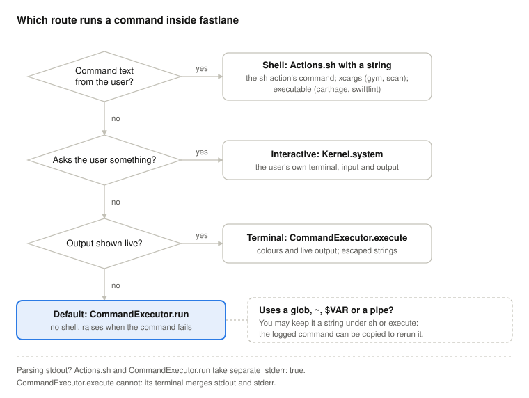

# Designing _fastlane_ code

The conventions changes to _fastlane_ are reviewed against. When a change needs something these do not cover, prefer the pattern the codebase already uses for the same problem, and say in the pull request when you introduce a new one.

## Action options

Options are declared with `FastlaneCore::ConfigItem` in `available_options`, and validated there rather than in `run`:

- `optional: false` for a required option. It is checked when the value is fetched, not when the configuration is built: with no value, _fastlane_ asks for one when it runs interactively, and fails with "No value found" on CI and in tests. An option that `run` never reads is never checked.
- `verify_block` for the value of a single option. It runs when the configuration is built, for the values passed as parameters.
- `conflicting_options` for options that cannot be used together, with `conflict_block` when the error needs a custom message.

A value comes from the first of these that has one: the parameter passed to the action, its `env_name`, the tool's configuration file, then `default_value` (see [priorities of parameters and options](https://docs.fastlane.tools/advanced/#priorities-of-parameters-and-options)).

### Known limits

A change should not work around these in a single action:

- `conflicting_options` only compares the options passed as parameters, when the configuration is built. A value that comes from an environment variable or a configuration file is never compared.
- `ConfigItem` has no "at least one of" mechanism. Checking it in `run` is the accepted pattern: `delete_keychain` (`:name` or `:keychain_path`), `upload_to_play_store` (`:apk` or `:apk_paths`), `get_managed_play_store_publishing_rights` (`:json_key` or `:json_key_data`).

### Environment variables are shared

Several actions can read the same `env_name`: `KEYCHAIN_NAME` is read by `create_keychain`, `delete_keychain` and `import_certificate`, and `KEYCHAIN_PATH` by those three and `setup_jenkins`. A variable a user exports for one action is also seen by the others, and a spec that does not clear it depends on the machine it runs on.

## Running commands

The route for a command run by _fastlane_'s own code:

- `Actions.sh` with a string, for command text the user wrote: the `sh` action's command, `xcargs` (_gym_, _scan_), `executable` (`carthage`, `swiftlint`). The user's quoting only works if a shell reads it.
- `Kernel#system`, for a command that asks the user something. Check its result: `true`, `false`, or `nil` when the command is not found.
- `FastlaneCore::CommandExecutor.execute`, for a tool that shows colours or progress only on a terminal. It always runs a string through the shell: escape values with `shellescape`.
- `FastlaneCore::CommandExecutor.run` otherwise: a program and its arguments, no shell, and it raises when the command fails.
- A command with a glob, `~`, `$VAR` or a pipe may stay a string under `Actions.sh` or `execute`: the logged command can then be copied to rerun it, and the shell's `*` skips dotfiles where `Dir.children` does not.
- To parse stdout, pass `separate_stderr: true` to `Actions.sh` or `run`; `execute` cannot separate them.
